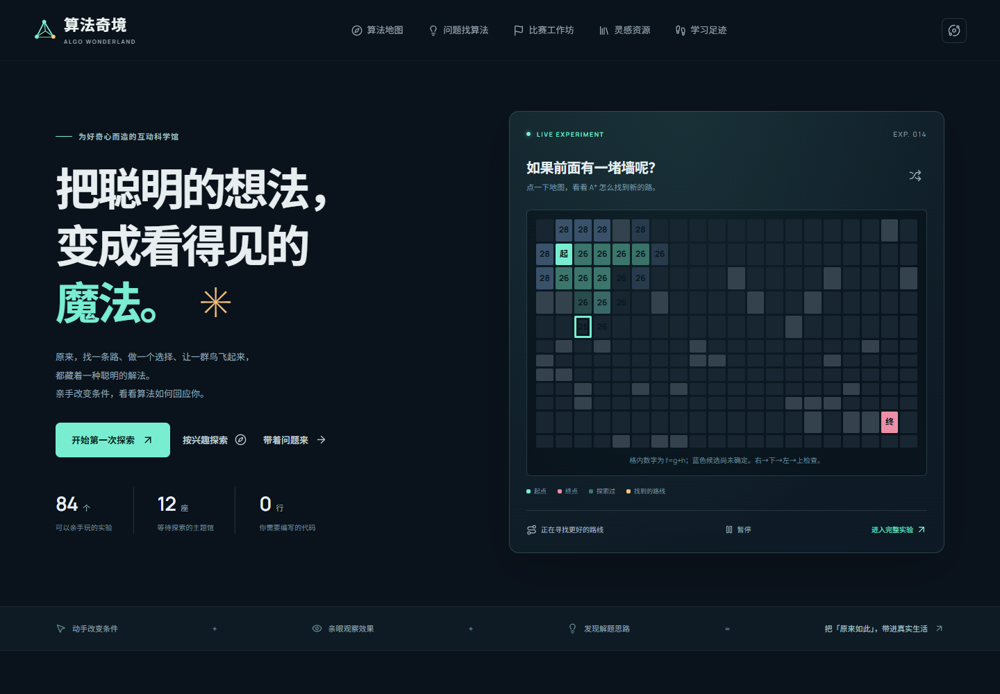
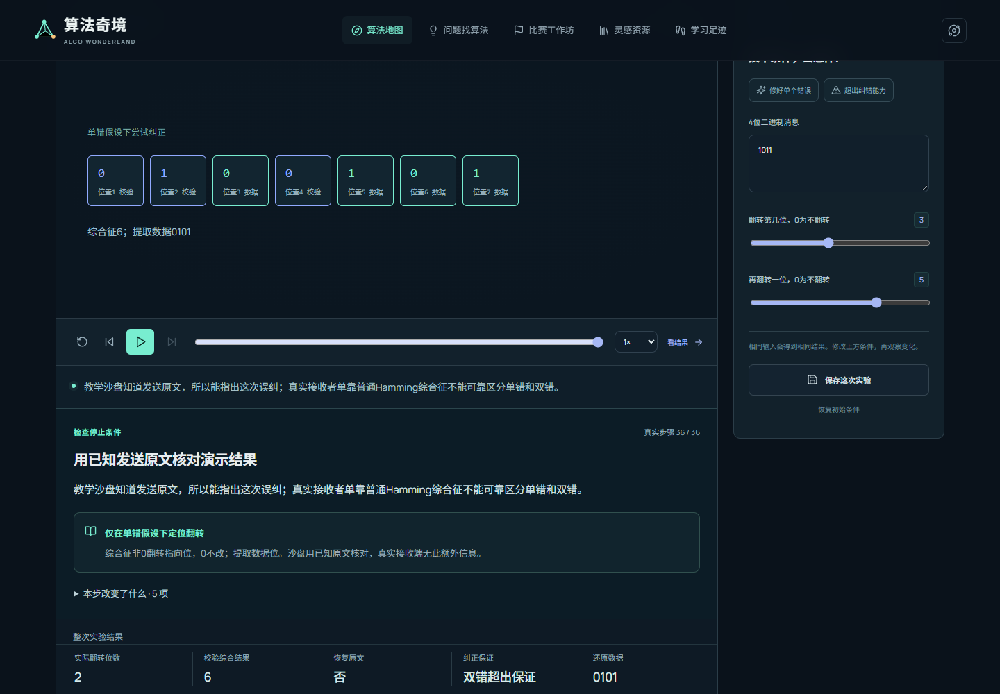

# 算法奇境 · Algorithm Wonderland

**可以亲手玩的中文算法体验馆：看效果、改条件、比较选择，理解每一步为什么发生。**

[立即在线体验 2.0](https://yangwei251003.github.io/algorithm-wonderland/) · [2.0 必要素材](https://github.com/yangwei251003/algorithm-wonderland/releases/tag/v2-source-review-2026-10-26) · [恢复与制作说明](docs/v2/开源恢复说明.md)



## 版本与完成状态

这是 **2.0 审查版源码**。2.0 交互与漫画现已发布至 GitHub Pages，无需本地启动。高清影片仍在本地审查；完整视听验收未通过。

- 84 个展项、12 个主题馆，带可改条件的真实计算、逐步规则、计算依据和生活类比。
- 252 张原创科普漫画，原图与冻结教学案例放在同版 Release 必要素材包。
- 16 项 Remotion 交互讲解，参数变化由后台计算更新。
- 原电脑已生成 84 条 1080p60、90–150 秒中文配音 Manim 影片，并完成技术与采样画面检查；**完整连续视听验收仍为 0/84**，影片和配音审查包保留本地。
- 本地审查包通过 84 项媒体功能检查和 96 次主例/反例章节跳转。测试范围与限制见 [QA_SUMMARY.md](QA_SUMMARY.md)。

## 开始体验或开发

1. 克隆本仓库，下载同版 Release 中的必要素材 ZIP，核对 `OPEN-ASSETS-MANIFEST.json` 的 SHA-256，解压到仓库根目录、合并目录。该附件已完成免登录整包下载与指纹验证，记录见 `qa/public-archive-verification.json`。
2. 安装 Node.js 22.12 或更新的兼容版本，在项目根运行：

```sh
npm ci
npm run dev
```

想直接使用时，打开上方在线体验链接即可；本节命令只用于本地开发。打开终端所示地址。交互计算在本机运行，不需要 API 密钥或登录。只克隆代码也可运行交互，但漫画需要素材附件；素材包不包含完整电影。

```sh
npm test
npm run build
npm run preview
```

收藏、学习记录和实验参数保存在浏览器，支持导出与导入；公开版和本地版不自动同步。不要直接双击构建后的 HTML，后台计算需要 HTTP 服务。

## 原理与媒体共用真实计算

`TraceEvent` 记录规则、代入数值、前后状态和选择依据。网页可逐步展开；同一教学案例供 Manim、Remotion 和漫画数值核对使用。候选明确区分待处理、选中与拒绝，启发式方法不保证全局最优。



网站采用 React、TypeScript、Vite、SVG/Canvas 和后台线程。影片使用 Manim Community 0.22.0 与本地保存的中文配音；Remotion 包固定同为 4.0.538。Python 仅用于影片制作，不是网站运行依赖。制作步骤、字体和平台限制见[恢复说明](docs/v2/开源恢复说明.md)。

## 文件与归档范围

| 内容 | 位置 |
| --- | --- |
| 网页、算法与教学源代码 | `src/` |
| 回归与已知答案检查 | `tests/` |
| 制作与打包工具 | `tools/`、`media/manim/`、`media/remotion/` |
| 84 项分镜与配音文字 | `media/scripts/` |
| 252 张漫画、冻结主例和反例 | Release 必要素材 ZIP，分别恢复至 `public/media/`、`media/exports/` |
| 每项 3 份对标记录 | `docs/research-v2/research-index.json` |
| 当前数量、审查边界 | `qa/v2-production-ledger.json`、`QA_SUMMARY.md` |

不公开下载的第三方论文/教材、参考站截图/正文、第三方技能正文、私人配置、依赖环境或渲染缓存。出处与第三方作者归属保留。完整 MP4/WAV 审查素材及机器审查记录仍在本地；本仓库不假称包含它们。

## 许可

原创代码、文档和作者拥有权利的原创素材采用 [MIT](LICENSE)。依赖和参考作品各自保留原许可；Remotion 有独立许可条件，详见 [开源与第三方说明](OPEN_SOURCE_NOTICES.md)。更新记录见 [CHANGELOG.md](CHANGELOG.md)。
